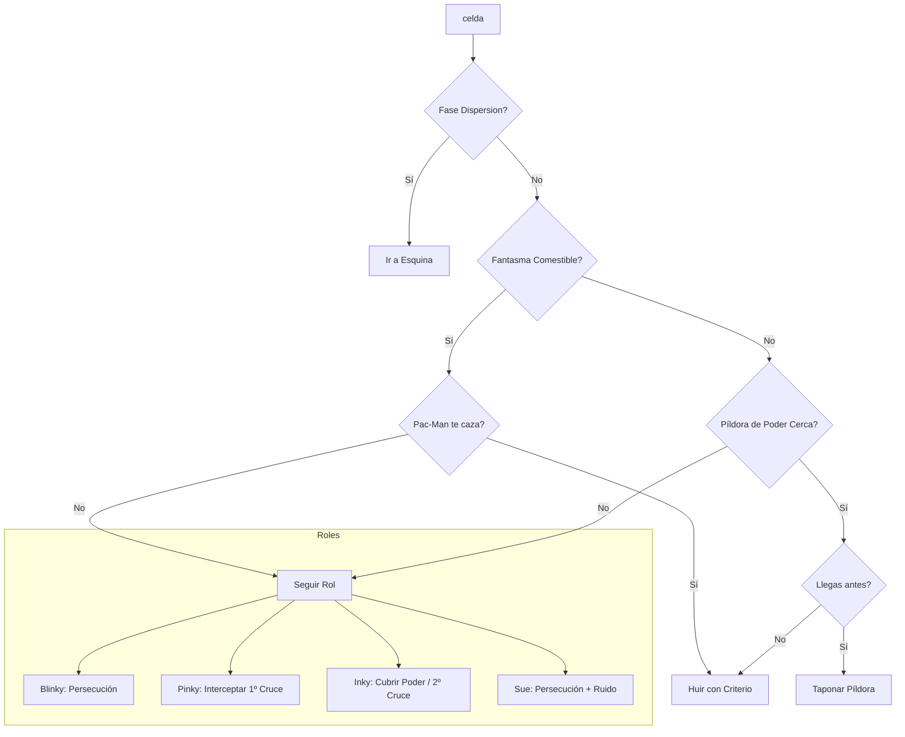

# Diario de desarrollo Práctica 1
### Contexto
Empezamos este proceso desde el código de la P0 de MissPacman:
```java
public  GHOST  getNearestChasingGhost(Game  game,  int  limit)  {
	GHOST result =  null;
	double min = limit;
	for(GHOST ghostype: GHOST.values())  {
		double aux = game.getDistance(game.getPacmanCurrentNodeIndex(), game.getGhostCurrentNodeIndex(ghostype), game.getPacmanLastMoveMade(), Constants.DM.EUCLID);
		if(aux < limit)  {
			if(aux < min)  {
				result = ghostype;
				min = aux;
			}
		}
	}
	return result;
}

@Override
public  MOVE  getMove(Game  game,  long  timeDue)  {
	int limit =  20;
	GHOST nearestGhost =  getNearestChasingGhost(game, limit);
	if(nearestGhost !=  null)  {
		if(!game.isGhostEdible(nearestGhost))  {
			return game.getApproximateNextMoveAwayFromTarget(game.getPacmanCurrentNodeIndex(), game.getGhostCurrentNodeIndex(nearestGhost), game.getPacmanLastMoveMade(), Constants.DM.EUCLID);
		}
		else game.getApproximateNextMoveTowardsTarget(game.getPacmanCurrentNodeIndex(), game.getGhostCurrentNodeIndex(nearestGhost), game.getPacmanLastMoveMade(), Constants.DM.EUCLID);
	}
	return game.getApproximateNextMoveTowardsTarget(game.getPacmanCurrentNodeIndex(), game.getClosestNodeIndexFromNodeIndex(game.getPacmanCurrentNodeIndex(), game.getActivePillsIndices(), Constants.DM.EUCLID), game.getPacmanLastMoveMade(), Constants.DM.EUCLID);
}
```
Con esta aproximación de la práctica 0 nos encontramos ante problemas claros como no poder ver más allá de ¿qué tengo más cerca? Mira siempre primero si hay fantasmas que sean comestibles o me pueden hacer daño y luego el resto de recursos del mapa.

Esta aproximación contra unos fantasmas aleatorios o los fantasmas que solo persiguen conseguían unas estadísticas tal que así:

``
Stats{Desc=PacMan decisiones simples contra perseguidores, average=4295.0, sum=429500.0, sumsq=2.2934588E9, sd=2129.0589280693757, n=100, min=1030.0, max=9320.0, stdErr=212.90589280693757, ms=1393}
``
``Stats{Desc=PacMan decisiones simples contra random, average=4557.9, sum=455790.0, sumsq=2.4760009E9, sd=2006.4433052976458, n=100, min=990.0, max=8810.0, stdErr=200.64433052976457, ms=410}``

lo que la verdad es un poco deprimente T_T, pero bueno uno tiene que empezar abajo para construir hacia arriba, ¿cierto?

## Proceso de ingeniería
Para iniciar con todo el proceso para llevar a cabo este controlador la idea fue realizar un SDD (Spec Driven Development) en el que primero se recogen y se definen todos los requisitos, se idea un plan de acción y la documentación pertinente y se usa un modelo de lenguaje para llevar a cabo la implementación.

Para una primera versión para el comportamiento del PacMan primero recogimos todos los requisitos:
- Decide solo cuando getPossibleMoves(nodo, ultimoMovimiento).length > 1. Con una sola opción devuelve esa opción sin calcular nada. No hay que usar isJunction como filtro: Ms. Pac-Man reaparece en un nodo al azar. 
- La idea es utilizar los conocimientos vistos en clase por lo que usar un modelo de mapas de influencia por capas sería lo más conveniente, con pesos variables para poder afinar.
- Utilizar los conceptos del tema de estrategias algorítmicas implementando el llegoYoAntes para ver si llega Pacman antes que los fantasmas a donde se está dirigiendo.
- Requisitos de uso del controlador, solo se toman decisiones en las intersecciones, y para la competición buscamos tomar la decisión en menos del timeDue.
- Reservamos los datos del laberinto solo una vez con el getMazeIndex

Entonces lo que nos resulta, verdaderamente relevante es como definir los mapas de influencia, y para ello, como no somos especialemente brillantes hemos decidido hacer algo casi identico a los apuntes. Un mapa con cuatro capas comida, amenza, presa y poder. 

Comida atrae a PacMan hacia casillas con pildoras normales, y de poder solo si no quedan normales, amenaza repele a PacMan porque dicta como de cerca están los fantasmas del propio PacMan, presa atrae a PacMan hacia fantasmas comestibles (solo si estoy a  2*distancia + MargenCaza < tiempoComestible(fantasma)) y poder atrae hacia donde estén las píldoras de poder.

Para cada capa, normalizamos dividiendo por el mayor de la capa para poder comparar en el salto de capas.

La utilidad de una casilla entonces quedaría definida por esta función:
$$
U(n) = wComida*comida - wAmenaza*amenaza + wPresa*presa + wPoder*poder
$$
Para una prueba inicial utilizaremos unas caidas equilibradas 0,9 en todos los pesos menos en presa para se emocione el colega si se encuentra un comestible que queremos puntos.
Pero para los pesos lo vamos a hacer muy miedoso no vaya a ser que vaya de cabeza contra los fantasmas.

La parte del prompt para el pacman entonces lo dejamos así:

- Decide solo cuando getPossibleMoves(nodo, ultimoMovimiento).length > 1. Con una sola opción devuelve esa opción sin calcular nada. No uses isJunction como filtro: Ms. Pac-Man reaparece en un nodo al azar.
- Cuatro capas, cada una un double[] con una casilla por nodo, reservado una vez por laberinto (cambia con getMazeIndex), junto con una tabla propia de vecinos copiada una sola vez. 
- * comida (atrae): una anchura multifuente con todas las píldoras. Las de poder solo entran aquí cuando no quedan píldoras normales. 
- * amenaza (repele): una anchura por fantasma fuera de la cárcel y no comestible, sumadas. La primera ola sale solo hacia delante, usando getNeighbouringNodes(nodo, ultimoMovimientoDelFantasma). Si devuelve null, hacia todos lados.
-  * presa (atrae): una anchura por fantasma comestible, y solo si 2·distancia + MARGEN_CAZA < tiempo comestible que le queda. 
- * poder: anchura multifuente desde las píldoras de poder, solo mientras queden píldoras normales. 
-  Cada capa se normaliza dividiendo por su máximo. Caídas: comida 0,90, amenaza 0,90, presa 0,85, poder 0,90. 
-  U(n) = wComida·comida − wAmenaza·amenaza + wPresa·presa + wPoder·poder. Pesos iniciales 1 / 6 / 2 / 1.  
-  Decisión: para cada salida legal, recorrer el pasillo hasta el siguiente cruce (incluido) y quedarse con el peor U del tramo. Gana la salida con el mejor peor-valor. Tope de 300 nodos por tramo.
-  Constructor con los tres pesos para poder probar variantes sin recompilar. 
-  Limitaciones conocidas que no hay que resolver ahora: no calcula "llego yo antes" ni predice a dónde irán los fantasmas.

Para los fantasmas:
Siempre tenemos que rellenar tono el EnumMap de los movimientos de los fantasmas.
Tenemos que elegir cuatro comportamientos que queramos de entre los propuestos y coordinarlos para acabar con pacman y vamos a elegir un perseguidor, un flanqueador, un cubre píldoras y un perseguidor pseudo aleatorio.
Hay comportamientos que tienen que seguir sí o sí como el de huir si son comestibles, que estén lo suficientemente dispersos.



- Rellenar el EnumMap solo para fantasmas con doesGhostRequireAction, y devolver siempre ese mapa. Distancias siempre con el último movimiento. 
-	Orden de prioridades por fantasma: 
-	1. Dispersión: si getCurrentLevelTime() < 80 y Ms. Pac-Man está a más de 25 nodos, ir a su esquina. La esquina es el nodo de una píldora de poder, elegida por GHOST.ordinal(). 
-	2. Si es comestible: huir, salvo que 3·tiempoComestible < 2·distancia a Ms. Pac-Man; entonces volver a perseguir. 
-	3. Si Ms. Pac-Man está a 12 nodos o menos de una píldora de poder activa: taponarla si el fantasma llega antes; si no, huir. 
-	4. Papel: BLINKY persigue por el camino más corto; PINKY va al próximo cruce de Ms. Pac-Man; INKY cubre la píldora de poder activa más cercana a Ms. Pac-Man y, si no hay, va al segundo cruce; SUE persigue con un 5 % de movimientos aleatorios legales. 
- Predicción del cruce de Ms. Pac-Man: sigue su pasillo hasta el cruce y, en el cruce, supone que sale hacia la píldora activa más cercana. Calculada una vez por turno. 
-  Huida: descartar la salida por la que viene Ms. Pac-Man y elegir la que maximiza la distancia a ella más 0,3 × la distancia al comestible compañero más cercano.

Por lo que con esto podemos empezar a hablar con nuestro modelo de confianza y forjar lo que sea que queramos hacer, aquí está la conversación:
```
Necesito dos controladores en Java para la Práctica 1 de IA para videojuegos
(Ms. Pac-Man y fantasmas). Adjunto: el enunciado, los apuntes del tema (incluido
el de mapas de influencia), Game.java, Constants.java y mis ficheros actuales.

OBJETIVO
Maximizar la puntuación media de MsPacMan y minimizar la que consiguen los
rivales con Ghosts, en la competición todos contra todos.

REGLAS DURAS
- Paquete: es.ucm.fdi.ici.c2627.practica1.grupoXX (mi grupo: HLI_EJB_CSB).
- Clases MsPacMan (extends PacmanController), Ghosts (extends GhostController)
  y Constantes. Máximo 500 líneas por comportamiento.
- Sin aprendizaje ni persistencia. Se puede guardar estado dentro de la partida.
- Sin visibilidad parcial, sin mensajes, 40 ms por turno.
- Sin código de depuración (nada de GameView) en ningún fichero.
- Usa solo métodos que existan en el Game.java adjunto. Si necesitas otro,
  dímelo en vez de suponerlo.
- Nunca restes índices de nodo. Usa DM.PATH y el último movimiento. Comprueba
  -1 y null donde se reciben. Comprueba la longitud de getShortestPath antes
  de acceder a camino[1].
- Todos los umbrales y pesos en Constantes, con nombre y un comentario cada uno.

DISEÑO DE MS. PAC-MAN: MAPA DE INFLUENCIA
- Decide solo cuando getPossibleMoves(nodo, ultimoMovimiento).length > 1.
  Con una sola opción devuelve esa opción sin calcular nada. No uses isJunction
  como filtro: Ms. Pac-Man reaparece en un nodo al azar.
- Cuatro capas, cada una un double[] con una casilla por nodo, reservado una
  vez por laberinto (cambia con getMazeIndex), junto con una tabla propia de
  vecinos copiada una sola vez.
    * comida (atrae): una anchura multifuente con todas las píldoras. Las de
      poder solo entran aquí cuando no quedan píldoras normales.
    * amenaza (repele): una anchura por fantasma fuera de la cárcel y no
      comestible, sumadas. La primera ola sale solo hacia delante, usando
      getNeighbouringNodes(nodo, ultimoMovimientoDelFantasma). Si devuelve
      null, hacia todos lados.
    * presa (atrae): una anchura por fantasma comestible, y solo si
      2·distancia + MARGEN_CAZA < tiempo comestible que le queda.
    * poder: anchura multifuente desde las píldoras de poder, solo mientras
      queden píldoras normales.
- Cada capa se normaliza dividiendo por su máximo. Caídas: comida 0,90,
  amenaza 0,90, presa 0,85, poder 0,90.
- U(n) = wComida·comida − wAmenaza·amenaza + wPresa·presa + wPoder·poder.
  Pesos iniciales 1 / 6 / 2.
- Signo de wPoder en cada turno:
    * con al menos 2 fantasmas peligrosos a 30 nodos o menos: +4 (atrae);
    * sin presión: −2 (repele, para no gastar la píldora de paso);
    * si lleva 120 turnos sin comer nada: 0 (final de nivel).
- Decisión: para cada salida legal, recorrer el pasillo hasta el siguiente
  cruce (incluido) y quedarse con el peor U del tramo. Gana la salida con el
  mejor peor-valor. Tope de 300 nodos por tramo.
- Constructor con los tres pesos para poder probar variantes sin recompilar.
- Limitaciones conocidas que no hay que resolver ahora: no calcula "llego yo
  antes" ni predice a dónde irán los fantasmas.

DISEÑO DE LOS FANTASMAS
- Rellenar el EnumMap solo para fantasmas con doesGhostRequireAction, y
  devolver siempre ese mapa. Distancias siempre con el último movimiento.
- Orden de prioridades por fantasma:
    1. Dispersión: si getCurrentLevelTime() < 80 y Ms. Pac-Man está a más de 25
       nodos, ir a su esquina. La esquina es el nodo de una píldora de poder,
       elegida por GHOST.ordinal().
    2. Si es comestible: huir, salvo que 3·tiempoComestible < 2·distancia a
       Ms. Pac-Man; entonces volver a perseguir.
    3. Si Ms. Pac-Man está a 12 nodos o menos de una píldora de poder activa:
       taponarla si el fantasma llega antes; si no, huir.
    4. Papel: BLINKY persigue por el camino más corto; PINKY va al próximo
       cruce de Ms. Pac-Man; INKY cubre la píldora de poder activa más cercana
       a Ms. Pac-Man y, si no hay, va al segundo cruce; SUE persigue con un 5 %
       de movimientos aleatorios legales.
- Predicción del cruce de Ms. Pac-Man: sigue su pasillo hasta el cruce y, en el
  cruce, supone que sale hacia la píldora activa más cercana. Calculada una
  vez por turno.
- Huida: descartar la salida por la que viene Ms. Pac-Man y elegir la que
  maximiza la distancia a ella más 0,3 × la distancia al comestible compañero
  más cercano.

ENTREGA
- Primero cinco líneas con el diseño y los números. Luego los ficheros.
- Dime qué NO has podido comprobar (compilar, medir) en vez de darlo por hecho.

Se adjuntaron 6 documentos

Voy a reescribir los dos controladores siguiendo el repertorio del enunciado y a sacar los umbrales a una clase de constantes.

Te he reescrito los dos controladores y una clase Constantes. No los he podido compilar ni probar porque no tengo el motor aquí, así que lo primero es compilarlos y lanzar runExperiment con 20 partidas o más.

Fallos de tu código original

Ghosts.getMove devolvía null en vez del EnumMap. Los fantasmas nunca recibían órdenes, así que seguían recto siempre.
Faltaba un return en MsPacMan, en la rama del fantasma comestible. Ese caso se perdía y caía a ir a por píldoras.
Usabas EUCLID y getApproximate… para decidir movimientos. Atraviesan paredes y miran un solo paso. Ahora todo va con DM.PATH y con el último movimiento.
Ms. Pac-Man trataba igual a todos los fantasmas. No miraba si estaban en la cárcel ni si eran comestibles, y huía de ellos todos por igual.

Ms. Pac-Man

Decide solo en los cruces: con getPossibleMoves(...).length == 1 devuelve la única salida sin calcular nada.
Razona por tramos: recorre cada salida hasta el siguiente cruce y cuenta las píldoras que hay por el camino.
¿Llego antes?: compara sus pasos hasta el cruce con la distancia de cada fantasma (con lastMove) más una holgura.
Mira dos cruces por delante: cada salida recibe un nivel de seguridad (0, 1 o 2), así detecta las trampas.
Prioridades solo sobre salidas seguras:
Primero fantasma comestible, solo si 2d + margen < tiempo comestible. La distancia máxima a la que persigue crece con los fantasmas ya comidos.
Luego píldora de poder, solo si hay fantasmas cerca.
Luego el tramo con más píldoras.
Si nada es seguro, la salida con más margen.
Píldora de poder: los tramos que la contienen se penalizan, para no gastarla de paso.
Final de nivel: si lleva 120 turnos sin comer, relaja la holgura a 0 para no quedarse bloqueada.

Fantasmas

Papeles:
Blinky persigue por el camino más corto.
Pinky intercepta el próximo cruce de Ms. Pac-Man.
Inky cubre la píldora de poder o corta el segundo cruce.
Sue persigue con un 5 % de ruido.
Predicción: supone que Ms. Pac-Man en un cruce tira hacia la píldora más cercana.
Dispersión inicial: cada fantasma va a una esquina, que es el nodo de una píldora de poder.
Anticipación de la píldora de poder: si Ms. Pac-Man está cerca de una, el fantasma que llega antes la tapona y los demás se dispersan.
Huida: descarta la salida por la que viene Ms. Pac-Man y se separa de otros comestibles.
Dejar de huir: deja de huir cuando 3·tiempo < 2·distancia.
Hueco en el mapa: solo se rellenan los fantasmas con doesGhostRequireAction.

Antes de entregar

Paquete: cambia grupoYY por tu grupo.
Depuración: DEBUG_PACMAN y DEBUG_GHOSTS están en false. Déjalos así al entregar.
Métodos del motor: uso getCurrentLevelTime(), getNumberOfActivePills() y getNumberOfActivePowerPills(), que salen en los apuntes. Si alguno no existe en tu versión del motor, avísame.
Afinado: prueba con varios rivales, como hace la tabla de afinar de los apuntes. Cambia las constantes de una en una y mide cada cambio con muchas partidas.


la clase game te ofrece estas funcionalidades:
*Documento java*
Y el propio juego tiene esta clase de constantes:
*Documento java*
Quiero que utilices mapas de influencia para decidir qué hara pacman como se especifica 
en el prompt y en el tema que te pasé antes de mapas de influencia.
No tengo una necesidad de la clase afinar ni de la información de debug.

Reescribo MsPacMan con el mapa de influencia del tema y ajusto Constantes para que lo acompañe. Ghosts no cambia.

He reescrito MsPacMan.java con el modelo del tema de mapas de influencia, y Constantes.java con los números nuevos. Ghosts.java sigue igual. No lo he compilado ni probado, porque no tengo el motor aquí.

Cómo funciona

Capas: cada una es un double[] con un número por nodo: comida (atrae), amenaza (repele), presa (atrae) y poder (atrae o repele según la situación).
Pintado: cada fuente reparte su influencia con una anchura por los pasillos, perdiendo fuerza en cada paso. La comida usa una sola anchura con todas las píldoras en la cola, y cada fantasma tiene la suya.
Normalización: cada capa se divide por su máximo, para que los pesos se puedan comparar entre sí.
Función objetivo: U(n) = wComida·comida − wAmenaza·amenaza + wPresa·presa ± wPoder·poder, con pesos por defecto 1 / 6 / 2.
Decisión: solo cuando getPossibleMoves(nodo, ultimo).length > 1. Para cada salida recorre el pasillo hasta el siguiente cruce y se queda con el peor U del tramo; gana la salida cuyo peor nodo es el menos malo.
Memoria: los arrays se reservan una vez por laberinto, y la comida solo se repinta cuando cambia el número de píldoras.
Constructor con pesos: new MsPacMan(w1, w2, w3) permite probar juegos de pesos sin recompilar, como en la tabla de afinar del tema.

Cambios respecto al listado del tema, que son lo que el propio tema señala como carencias en su sección «Hasta dónde llega un mapa solo»:

Presa alcanzable: un fantasma comestible solo pinta presa si 2d + margen < tiempo comestible; si no, se ignora.
Poder con signo según la situación:
Con al menos 2 fantasmas peligrosos a 30 nodos o menos, la píldora de poder atrae con peso 4.
Sin presión, repele con peso 2, para no gastarla de paso.
Si lleva 120 turnos sin comer, deja de repelerla, para evitar el bloqueo del final de nivel.
Cuando no quedan píldoras normales, las de poder pasan a la capa de comida.
Filtro de decisión: uso getPossibleMoves(...).length > 1 en vez de isJunction, porque Ms. Pac-Man aparece en un nodo al azar.
Protecciones: los null de getNeighbouringNodes y los pasillos con menos de dos vecinos están controlados.
Constantes: todos los números salen a Constantes, y la depuración (DEBUG_PACMAN) está en false.

Para afinar, cambia un peso cada vez y mide con muchas partidas contra varios rivales. Para ver qué pinta cada capa, pon DEBUG_PACMAN = true y sustituye utilidad(n) por una sola capa en depurar. Antes de entregar, deja el interruptor otra vez en false.

Explícame por qué siguen apareciendo las constantes de debug de MsPacMan y de los Fantasmas y para qué sirven.

DEBUG_PACMAN activa la depuración visual de Ms. Pac-Man. Con true, MsPacMan pinta con GameView.addPoints el valor U de cada nodo sobre el laberinto: amarillo lo que suma, rojo lo que resta, y más opaco cuanto más lejos del cero. Además, con el interruptor encendido pinta en todos los turnos, no solo en los cruces. GameView borra lo dibujado en cada fotograma, y si solo se pintara en los cruces el mapa parpadearía. Para verlo, pon DEBUG_PACMAN = true y lanza el ExecutorTest de la plantilla, que ya trae setVisual(true).

Para ver una capa sola, cambia el cuerpo de utilidad(n) por, por ejemplo, -amenaza[n] o comida[n]. Así se ve enseguida si la mancha de amenaza sale hacia delante del fantasma o hacia los dos lados.

DEBUG_GHOSTS no hace nada ahora mismo. La declaré en Constantes por simetría, pero en Ghosts.java no escribí ninguna llamada a GameView, así que cambiarla no tiene efecto. Si quieres depurar los fantasmas, puedo añadirla, por ejemplo con una línea de cada fantasma a su objetivo y un color por papel. Siempre detrás de ese if (Constantes.DEBUG_GHOSTS).

Antes de entregar, déjalas las dos en false. addPoints y addLines no dibujan: apuntan en listas static que solo se vacían al repintar la ventana. En la corrección no hay ventana, así que en miles de partidas se agota la memoria y se cae la ejecución de todos. Como son static final, con false el compilador elimina esas llamadas por completo.

quita eso de todos lados, de los fantasmas y de pacman y además.

Y si además quieres que aguante el modo con reloj
La clase Controller te deja el campo lastMove como protected, y el comentario del propio motor dice para qué: «You can set this directly in your getMove() method to save an immediate response». Es el patrón anytime del que habla el tema 5: apunta enseguida un movimiento decente, sigue calculando, y ve mejorándolo.

@Override
public MOVE getMove(Game game, long timeDue) {
    lastMove = movimientoRapidoYSeguro(game);   // ya hay respuesta si preguntan

    while (System.currentTimeMillis() < timeDue - 2) {
        MOVE mejor = seguirPensando(game);      // una vuelta más de búsqueda
        if (mejor != null) lastMove = mejor;
    }
    return lastMove;
}
Para esta práctica no hace falta, porque la corrección espera. Pero es la forma correcta de escribirlo si alguna vez el reloj es de verdad, y no cuesta nada dejarlo así desde el principio.

¿Esto está implementado? Porque no me parece verlo por ninguna parte.

Quito la depuración de Constantes y de MsPacMan; en Ghosts no había ninguna.

Quitada la depuración: ya no queda DEBUG_PACMAN, DEBUG_GHOSTS, depurar ni los imports de Color y GameView. Ghosts.java nunca usó esas constantes, así que no ha cambiado.

¿Está implementado el patrón anytime (lastMove + bucle hasta timeDue)? No. Ninguno de los dos controladores toca lastMove ni itera mientras queda tiempo. Cada getMove calcula una sola vez y devuelve.

En esta práctica no hace falta, porque la corrección usa runExperiment y el motor espera a que devuelvas. Aun así, con reloj real tampoco tendría problema, porque la respuesta es muy rápida:

Pasillos: devuelven la única salida sin calcular nada.
Cruces: la decisión es muy barata. Con un controlador parecido, el tema mide unos 0,03 ms por cruce frente a los 40 ms de presupuesto. No sé cuánto tarda exactamente el mío, así que conviene medirlo.
Primera llamada: es la más cara (unos 39 ms en esa medida, por cargar clases y reservar arrays). En modo con reloj podría perder un turno al empezar, y no tiene consecuencias.

Un bucle anytime solo tendría sentido si el cálculo fuera iterativo y mejorable, como una búsqueda con profundidad creciente. Mi decisión es una pasada fija, así que el bucle no tendría nada que mejorar.

Si quieres dejarlo preparado «desde el principio», lo mínimo es asignar lastMove = ops[0] al inicio de getMove, que no cuesta nada. Dime si lo añado.
```
Tras esto tenemos un pacman y unos fantasmas funcionales para el que conseguimos unas estadísticas tal que así:

```
Stats{Desc=PacMan Mapa de Influencia contra perseguidores normales, average=8998.5, sum=899850.0, sumsq=8.7155095E9, sd=2498.9073875022123, n=100, min=3330.0, max=14190.0, stdErr=249.89073875022123, ms=2111}

Stats{Desc=PacMan decisiones simples contra random, average=8363.5, sum=836350.0, sumsq=7.4003055E9, sd=2023.8284427432493, n=100, min=2600.0, max=14380.0, stdErr=202.38284427432492, ms=1024}

Stats{Desc=PacmanMapaInfluencia contra enemigos organizados, average=5330.1, sum=533010.0, sumsq=3.6233583E9, sd=2811.1640692500364, n=100, min=700.0, max=15190.0, stdErr=281.1164069250036, ms=543}
```
A partir de aquí queremos hacer afinación de lo que hemos hecho por lo que vamos a hacer de informáticos y codearlo nosotros ¿no?

Así que decidimos picar una clase para afinar.

`Afinar.java` es un script de optimización externa que aplica Coordinate Ascent para encontrar los pesos y factores de decaimiento óptimos del controlador de Ms. Pac-Man. 
 Primero evalúa los parámetros iniciales contra todos los rivales (50 partidas). 
 Modifica un parámetro a la vez probando sus candidatos predefinidos. Conserva el valor si la media supera la mejor conocida. 
Reevalúa la configuración inicial vs. la afinada con un mayor número de partidas para descartar el ruido. Rendimiento Global por Configuración Dada una suite de 4 rivales, la puntuación media global ($\bar{X}$) y el error estándar acumulado ($\sigma_{\bar{X}}$) se calculan como: $$\bar{X} = \frac{1}{R} \sum_{r=1}^{R} m_r$$ $$\sigma_{\bar{X}} = \frac{\sqrt{\sum_{r=1}^{R} \varepsilon_r^2}}{R}$$ *Donde $m_r$ es la media obtenida contra el rival $r$, y $\varepsilon_r$ es su error relativo.
 Al comparar la configuración inicial ($A$) con la afinada ($B$), se calcula la diferencia de medias y la propagación de errores: $$\Delta = \bar{X}_B - \bar{X}_A$$ $$\sigma_{\Delta} = \sqrt{\sigma_A^2 + \sigma_B^2}$$  Se exige que $\Delta \ge 2 \cdot \sigma_{\Delta}$ (intervalo de confianza $\approx 95\%$). Si la diferencia no supera los dos errores estándar, la supuesta mejora se clasifica como **ruido aleatorio**.

(esta solución está basada en el algoritmo de Coordinate Ascent de la Universidad de Massachussets ideada para Machine Learning subida a la librería Ranklib de Java, no es un calco pero intenta serlo, lo intentamos hacer a mano pero cuando estuvimos a punto de morir al intentarlo nos apoyamos de Claude, lastimosamente no tengo la conversación, lo siento Pablo T_T)

```java
package es.ucm.fdi.ici.c2627.practica0.grupoHLI_EJB_CSB;

import java.util.EnumMap;
import java.util.Locale;
import java.util.Random;

import pacman.Executor;
import pacman.controllers.GhostController;
import pacman.game.Constants.DM;
import pacman.game.Constants.GHOST;
import pacman.game.Constants.MOVE;
import pacman.game.Game;
import pacman.game.util.Stats;

/**
 * Afinado por coordenadas: se parte de los valores de Constantes y, parámetro a parámetro,
 * se prueba cada candidato contra TODOS los rivales y se queda el que mejor puntúa de media.
 * Al final se confirma el resultado con más partidas frente a los valores de partida.
 *
 * Uso: java Afinar [partidasPorRival] [partidasConfirmacion]   (por defecto 50 y 300)
 *
 * Es una herramienta externa: el controlador entregado no lee nada. Los números que salgan
 * se copian a mano en Constantes.
 */
public class Afinar {

    // Orden de los parámetros: el peso de la comida se fija a 1 (sólo importan las proporciones).
    private static final String[] NOMBRES = {
        "PESO_AMENAZA", "PESO_PRESA", "PESO_PODER_ATRAE", "PESO_PODER_EVITA",
        "CAIDA_COMIDA", "CAIDA_AMENAZA", "CAIDA_PRESA", "CAIDA_PODER"
    };

    private static final double[][] CANDIDATOS = {
        {1, 3, 6, 10, 20},
        {0, 1, 2, 4, 6},
        {1, 2, 4, 8},
        {0, 1, 2, 4},
        {10, 0, 10, 0},
        {0.75, 0.85, 0.90, 0.95},
        {0.70, 0.80, 0.90, 0.95},
        {0.70, 0.85, 0.90},
        {0.80, 0.90, 0.95},
        {0.30, 0.9, 0.9, 0.9}
    };

    private static final int PASADAS = 1;

    /** Resultado de evaluar un juego de parámetros contra todos los rivales. */
    private static final class Resultado {
        final double media;     // media de las medias por rival
        final double error;     // error típico de esa media
        final double[] porRival;
        Resultado(double media, double error, double[] porRival) {
            this.media = media;
            this.error = error;
            this.porRival = porRival;
        }
    }

    public static void main(String[] args) {
        int partidas = args.length > 0 ? Integer.parseInt(args[0]) : 50;
        int confirmacion = args.length > 1 ? Integer.parseInt(args[1]) : 100;

        Executor executor = new Executor.Builder()
                .setVisual(false)
                .setTickLimit(4000)
                .setPacmanPO(false)
                .setGhostPO(false)
                .setGhostsMessage(false)
                .build();
        GhostController[] rivales = rivales();

        double[] inicial = {
            Constantes.PESO_AMENAZA, Constantes.PESO_PRESA,
            Constantes.PESO_PODER_ATRAE, Constantes.PESO_PODER_EVITA,
            Constantes.CAIDA_COMIDA, Constantes.CAIDA_AMENAZA,
            Constantes.CAIDA_PRESA, Constantes.CAIDA_PODER
        };
        double[] actual = inicial.clone();
        Resultado mejor = evaluar(executor, rivales, actual, partidas);
        imprimir("partida", actual, mejor);

        for (int pasada = 1; pasada <= PASADAS; pasada++) {
            System.out.println("\n=== Pasada " + pasada + " ===");
            for (int i = 0; i < NOMBRES.length; i++) {
                double valorActual = actual[i];
                for (double candidato : CANDIDATOS[i]) {
                    if (candidato == valorActual) continue;
                    double[] prueba = actual.clone();
                    prueba[i] = candidato;
                    Resultado r = evaluar(executor, rivales, prueba, partidas);
                    imprimir(NOMBRES[i] + "=" + candidato, prueba, r);
                    if (r.media > mejor.media) {
                        mejor = r;
                        actual = prueba;
                    }
                }
                System.out.printf(Locale.ROOT, "--> %s se queda en %s%n", NOMBRES[i], actual[i]);
            }
        }

        System.out.println("\n=== Confirmación con " + confirmacion + " partidas por rival ===");
        Resultado a = evaluar(executor, rivales, inicial, confirmacion);
        Resultado b = evaluar(executor, rivales, actual, confirmacion);
        imprimir("valores de partida", inicial, a);
        imprimir("valores afinados", actual, b);

        double diferencia = b.media - a.media;
        double errorDiferencia = Math.sqrt(a.error * a.error + b.error * b.error);
        System.out.printf(Locale.ROOT, "%nMejora: %.0f ± %.0f (si es menor que 2 errores, es ruido)%n",
                diferencia, errorDiferencia);
        System.out.println("\nPara pegar en Constantes:");
        for (int i = 0; i < NOMBRES.length; i++) {
            System.out.printf(Locale.ROOT, "  %s = %s%n", NOMBRES[i], actual[i]);
        }
    }

    /** Rival de referencia: añade aquí los fantasmas de otros grupos (jar en el classpath). */
    private static GhostController[] rivales() {
        return new GhostController[] {
            new GhostsHLI_EJB_CSB(),                  // los tuyos
            new Ghosts(),           // persecución directa por el camino más corto
            new GhostsRandom(),
            new GhostsElkin()// movimientos legales al azar
            // , new otro.paquete.Ghosts()   <- los de otros grupos
        };
    }

    private static Resultado evaluar(Executor executor, GhostController[] rivales, double[] p, int partidas) {
        double[] medias = new double[rivales.length];
        double sumaVarianzas = 0;
        double suma = 0;
        for (int r = 0; r < rivales.length; r++) {
        	MsPacManHLI_EJB_CSB pacman = new MsPacManHLI_EJB_CSB(1.0, p[0], p[1], p[2], p[3], p[4], p[5], p[6], p[7]);
            Stats[] s = executor.runExperiment(pacman, rivales[r], partidas, "afinar");
            medias[r] = s[0].getAverage();
            suma += medias[r];
            sumaVarianzas += s[0].getStandardError() * s[0].getStandardError();
        }
        double media = suma / rivales.length;
        double error = Math.sqrt(sumaVarianzas) / rivales.length;
        return new Resultado(media, error, medias);
    }

    private static void imprimir(String etiqueta, double[] p, Resultado r) {
        StringBuilder sb = new StringBuilder();
        for (double m : r.porRival) {
            sb.append(String.format(Locale.ROOT, " %.0f", m));
        }
        System.out.printf(Locale.ROOT, "%-26s media %.0f ± %.0f   por rival:%s%n",
                etiqueta, r.media, r.error, sb);
    }
```

Con esta clase se consiguieron los siguientes resultados tras probar con una configuración Miedosa, Atrevida y Equilibrada, contra todos los fantasmas que tenemos, los que hicimos esta práctica (GhostsHLI..., GhostsElkin) y la anterior:

```
valores de partida media 7811 ± 108 por rival: 5040 8704 8423 9077

valores afinados media 7804 ± 115 por rival: 5394 8621 8358 8845

  

Mejora: -7 ± 158 (si es menor que 2 errores, es ruido)

  

Para pegar en Constantes:

PESO_AMENAZA = 10.0

PESO_PRESA = 6.0

PESO_PODER_ATRAE = 4.0

PESO_PODER_EVITA = 0.0

CAIDA_COMIDA = 0.95

CAIDA_AMENAZA = 0.9

CAIDA_PRESA = 0.85

CAIDA_PODER = 0.8
```
Bien maravilloso pero se nos olvidó implementar lo de a ver si llego yo antes que los fantasmas, vamos a ver como podemos solucionarlo.

```java
private  double  valorarTramo(Game  game,  int  desde,  MOVE  m)  {

int  anterior  =  desde;

int  n  =  game.getNeighbour(desde,  m);

double  peor  =  Double.POSITIVE_INFINITY;

for  (int  i  =  0;  i  <  Constantes.MAX_TRAMO  &&  n  >=  0;  i++)  {

peor  =  Math.min(peor,  utilidad(n));

if  (game.isJunction(n)  ||  vecinos[n].length  <  2)  {

return  peor;

}

// un  nodo  de  pasillo  tiene  dos  vecinos: el siguiente  es el que no es el anterior

int  siguiente  =  (vecinos[n][0]  ==  anterior)  ?  vecinos[n][1]  :  vecinos[n][0];

anterior  =  n;

n  =  siguiente;

}

return  peor  ==  Double.POSITIVE_INFINITY  ?  Double.NEGATIVE_INFINITY  :  peor;

}
```

Este es el código original para el que se consigue la media anterior. 

Probemos simplemente a mirar si algún fantasma va a llegar antes que nosotros y si es así no cogemos ese camino:

```java
private  double  valorarTramo(Game  game,  int  desde,  MOVE  m)  {

int  anterior  =  desde;

int  n  =  game.getNeighbour(desde,  m);

double  peor  =  Double.POSITIVE_INFINITY;

int  pasosPacman  =  0;

  

for  (int  i  =  0;  i  <  Constantes.MAX_TRAMO  &&  n  >=  0;  i++)  {

pasosPacman++;

  

// Validar  anticipación: si el fantasma  llega  antes a este  nodo, el tramo  es mortal

if  (!llegoAntes(game,  n,  pasosPacman))  {

return  Double.NEGATIVE_INFINITY;

}

  

peor  =  Math.min(peor,  utilidad(n));

if  (game.isJunction(n)  ||  vecinos[n].length  <  2)  {

return  peor;

}

int  siguiente  =  (vecinos[n][0]  ==  anterior)  ?  vecinos[n][1]  :  vecinos[n][0];

anterior  =  n;

n  =  siguiente;

}

return  peor  ==  Double.POSITIVE_INFINITY  ?  Double.NEGATIVE_INFINITY  :  peor;

}
```

Y para este código nos salen los siguientes resultados:
```
Stats{Desc=PacMan decisiones simples contra perseguidores, average=8237.4, sum=823740.0, sumsq=7.2427092E9, sd=2149.073852672919, n=100, min=1900.0, max=14830.0, stdErr=214.90738526729191, ms=3304}

Stats{Desc=PacMan decisiones simples contra random, average=7617.9, sum=761790.0, sumsq=6.0230489E9, sd=1490.0642620539911, n=100, min=3830.0, max=11040.0, stdErr=149.00642620539912, ms=2176}

Stats{Desc=PacmanMapaInfluencia con llego yo antes, average=3961.8, sum=396180.0, sumsq=1.9813226E9, sd=2039.351937070285, n=100, min=940.0, max=11340.0, stdErr=203.9351937070285, ms=2255}
```

Son más bajos que de la otra manera, rarete.

Bueno igual hacerlo que no tome el camino es demasiado radical, vamos a hacer que se añada otra capa más con la anticipación y que la penalización sea más suave:

```java
private  double  valorarTramo(Game  game,  int  desde,  MOVE  m)  {

int  anterior  =  desde;

int  n  =  game.getNeighbour(desde,  m);

double  peorUtilidadTramo  =  Double.POSITIVE_INFINITY;

int  pasosPacman  =  0;

double  penalizacionAcumulada  =  0.0;

  

for  (int  i  =  0;  i  <  Constantes.MAX_TRAMO  &&  n  >=  0;  i++)  {

pasosPacman++;

  

// Obtenemos el factor de  penalización  suave  para  este  nodo  específico

double  penalizacionNodo  =  calcularPenalizacionAnticipacion(game,  n,  pasosPacman);

penalizacionAcumulada  +=  penalizacionNodo;

  

// Calculamos  la  utilidad normal del  nodo  restándole el castigo  por  proximidad  fantasma

double  utilNodo  =  utilidad(n)  -  penalizacionNodo;

peorUtilidadTramo  =  Math.min(peorUtilidadTramo,  utilNodo);

  

if  (game.isJunction(n)  ||  vecinos[n].length  <  2)  {

break;

}

  

int  siguiente  =  (vecinos[n][0]  ==  anterior)  ?  vecinos[n][1]  :  vecinos[n][0];

anterior  =  n;

n  =  siguiente;

}

  

return  peorUtilidadTramo  ==  Double.POSITIVE_INFINITY  ?  Double.NEGATIVE_INFINITY  :  peorUtilidadTramo;

}
```

Nuestros resultados son los siguientes:

```
Stats{Desc=PacMan decisiones simples contra perseguidores, average=7200.8, sum=720080.0, sumsq=5.6994904E9, sd=2279.3281306720028, n=100, min=1300.0, max=12300.0, stdErr=227.93281306720027, ms=3277}

Stats{Desc=PacMan decisiones simples contra random, average=7002.4, sum=700240.0, sumsq=5.176814E9, sd=1661.973464884382, n=100, min=2780.0, max=11480.0, stdErr=166.1973464884382, ms=2094}

Stats{Desc=PacmanMapaInfluencia con llego yo antes, average=3164.9, sum=316490.0, sumsq=1.1923023E9, sd=1387.6915610779179, n=100, min=1250.0, max=7710.0, stdErr=138.7691561077918, ms=2218}
```

Pues son aún peores en numeros absolutos pero mucho menos variables que la anterior.

Vamos a probar con una comprobación de dos niveles, miraremos una intersección y trataremos ver la siguiente:
```java
private  double  valorarTramo(Game  game,  int  desde,  MOVE  m)  {

// --- NIVEL 1: Primer tramo  hasta el primer cruce ---

int  anterior  =  desde;

int  n  =  game.getNeighbour(desde,  m);

double  peorNivel1  =  Double.POSITIVE_INFINITY;

int  pasosPacman  =  0;

int  primerCruce  =  -1;

MOVE  ultimaMovCruce1  =  m;

  

for  (int  i  =  0;  i  <  Constantes.MAX_TRAMO  &&  n  >=  0;  i++)  {

pasosPacman++;

  

// Validación  de  llegada  antes  en el primer tramo

if  (!llegoAntes(game,  n,  pasosPacman))  {

return  Double.NEGATIVE_INFINITY;

}

  

peorNivel1  =  Math.min(peorNivel1,  utilidad(n));

  

// Si  encontramos  un  cruce o un final de  camino

if  (game.isJunction(n)  ||  vecinos[n].length  <  2)  {

primerCruce  =  n;

break;

}

  

int  siguiente  =  (vecinos[n][0]  ==  anterior)  ?  vecinos[n][1]  :  vecinos[n][0];

anterior  =  n;

n  =  siguiente;

}

  

// Si no se  encontró  ningún  cruce  válido, devolvemos  lo  peor  del primer tramo

if  (primerCruce  ==  -1  ||  vecinos[primerCruce].length  <=  1)  {

return  peorNivel1  ==  Double.POSITIVE_INFINITY  ?  Double.NEGATIVE_INFINITY  :  peorNivel1;

}

  

// --- NIVEL 2: Evaluar  las  salidas  desde el primer cruce ---

MOVE[]  opsNivel2  =  game.getPossibleMoves(primerCruce,  ultimaMovCruce1);

if  (opsNivel2.length  ==  0)  {

return  Double.NEGATIVE_INFINITY;  // Callejón sin salida real

}

  

double  mejorPeorNivel2  =  Double.NEGATIVE_INFINITY;

boolean  alMenosUnaSalidaSegura  =  false;

  

for  (MOVE  m2  :  opsNivel2)  {

int  ant2  =  primerCruce;

int  n2  =  game.getNeighbour(primerCruce,  m2);

double  peorEsteSegundoTramo  =  Double.POSITIVE_INFINITY;

int  pasosNivel2  =  pasosPacman;

boolean  tramo2Valido  =  true;

  

for  (int  j  =  0;  j  <  Constantes.MAX_TRAMO  &&  n2  >=  0;  j++)  {

pasosNivel2++;

  

// Validar  si  los  fantasmas  interceptan  en  este  segundo  nivel

if  (!llegoAntes(game,  n2,  pasosNivel2))  {

tramo2Valido  =  false;

break;

}

  

peorEsteSegundoTramo  =  Math.min(peorEsteSegundoTramo,  utilidad(n2));

  

if  (game.isJunction(n2)  ||  vecinos[n2].length  <  2)  {

break;

}

  

int  sig2  =  (vecinos[n2][0]  ==  ant2)  ?  vecinos[n2][1]  :  vecinos[n2][0];

ant2  =  n2;

n2  =  sig2;

}

  

if  (tramo2Valido)  {

alMenosUnaSalidaSegura  =  true;

mejorPeorNivel2  =  Math.max(mejorPeorNivel2,  peorEsteSegundoTramo);

}

}

  

// Si  desde el primer cruce TODAS las  salidas  llevan a ser  atrapados, el tramo  es  una  trampa

if  (!alMenosUnaSalidaSegura)  {

return  Double.NEGATIVE_INFINITY;

}

  

// Combinamos  de  forma  conservadora el peor  caso  del  nivel 1 y el mejor  de  los  peores  del  nivel 2

return  Math.min(peorNivel1,  mejorPeorNivel2);

}
```
Y...
```
Stats{Desc=PacMan decisiones simples contra perseguidores, average=4308.8, sum=430880.0, sumsq=2.188591E9, sd=1831.3081265984308, n=100, min=1230.0, max=9300.0, stdErr=183.1308126598431, ms=4777}

Stats{Desc=PacMan decisiones simples contra random, average=4477.2, sum=447720.0, sumsq=2.2449984E9, sd=1558.5100888251243, n=100, min=2260.0, max=8780.0, stdErr=155.85100888251242, ms=3235}

Stats{Desc=PacmanMapaInfluencia con llego yo antes, average=3011.8, sum=301180.0, sumsq=1.0947994E9, sd=1376.958572031457, n=100, min=980.0, max=8320.0, stdErr=137.6958572031457, ms=3371}
```

Jesús Nazareno y la Virgen del Carmen qué está pasando!!
No solo nos encontramos con que la media es más baja y es más estable, sino que para los controladores de fantasmas más simples le pasa lo mismo.

El problema es que lo estamos haciendo Over-Cautious, nuestra capa de amenaza ya ataca estos problemas con una caida geométrica de los valores a medida que nos alejamos del fantasma, la idea sería que el incentivo no se solapase o perdiera sentido. 

Pero aun poniendo un incentivo más pequeño seguimos con medias de 2800 puntos para los fantasmas complicamos. 

Vamos a probar a poner una penalización constante, que no altere nuestros mapas de influencia poniendo wAnticipación a 0 y rezando porque sea eso

```java
private  double  valorarTramo(Game  game,  int  desde,  MOVE  m)  {

int  anterior  =  desde;

int  n  =  game.getNeighbour(desde,  m);

double  peorUtilidadTramo  =  Double.POSITIVE_INFINITY;

int  pasosPacman  =  0;

boolean  fantasmaGanaEnElTramo  =  false;

  

for  (int  i  =  0;  i  <  Constantes.MAX_TRAMO  &&  n  >=  0;  i++)  {

pasosPacman++;

  

// Comprobamos  si  algún  fantasma  llega  antes a este  nodo  del  tramo

for  (GHOST  f  :  GHOST.values())  {

if  (game.isGhostEdible(f)  ||  game.getGhostLairTime(f)  >  0)  continue;

  

int  nodoFantasma  =  game.getGhostCurrentNodeIndex(f);

MOVE  ultFantasma  =  game.getGhostLastMoveMade(f);

int  susPasos  =  game.getShortestPathDistance(nodoFantasma,  n,  ultFantasma);

  

// Si el fantasma  llega  antes o a la  vez (con  holgura  de 1 paso)

if  (susPasos  >=  0  &&  susPasos  <  pasosPacman  +  1)  {

fantasmaGanaEnElTramo  =  true;

break;

}

}

  

double  utilNodo  =  utilidad(n);

// Si el fantasma  nos  gana  en  este  punto, penalizamos  la  utilidad  de  este  nodo  específico

if  (fantasmaGanaEnElTramo)  {

utilNodo  -=  2.5;  // Penalización  ajustable: suficiente  para  desincentivar, pero no un -INF total

}

  

peorUtilidadTramo  =  Math.min(peorUtilidadTramo,  utilNodo);

  

if  (game.isJunction(n)  ||  vecinos[n].length  <  2)  {

break;

}

  

int  siguiente  =  (vecinos[n][0]  ==  anterior)  ?  vecinos[n][1]  :  vecinos[n][0];

anterior  =  n;

n  =  siguiente;

}

  

return  peorUtilidadTramo  ==  Double.POSITIVE_INFINITY  ?  Double.NEGATIVE_INFINITY  :  peorUtilidadTramo;

}
```

Y...

```
Stats{Desc=PacMan decisiones simples contra perseguidores, average=8873.3, sum=887330.0, sumsq=8.3303293E9, sd=2148.0176696412273, n=100, min=2640.0, max=14360.0, stdErr=214.80176696412272, ms=3297}

Stats{Desc=PacMan decisiones simples contra random, average=7815.7, sum=781570.0, sumsq=6.3850977E9, sd=1671.450863740538, n=100, min=2470.0, max=13090.0, stdErr=167.1450863740538, ms=2182}

Stats{Desc=PacmanMapaInfluencia con llego yo antes, average=4230.1, sum=423010.0, sumsq=2.1541147E9, sd=1919.4383095693438, n=100, min=1490.0, max=11620.0, stdErr=191.9438309569344, ms=2011}
```

Vale no me esperaba que esto fuese a funcionar, pero bueno sigue siendo peor que nuestra primera implementación pero es mejor que cualquier otra que mira si llego antes a la intersección.